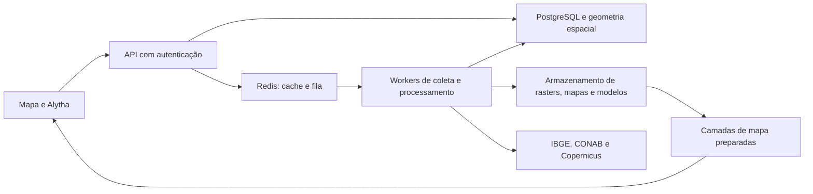

# Plano de preparação para produção — Alytha

Data: 14/10/2026. Proposta para começar com um piloto controlado de produtores parceiros e ampliar conforme resultados de carga e validação. Esta arquitetura ainda não está implementada; não autoriza contratação de serviços nem publicação.

## Ponto de partida verificado

A aplicação atende localmente com `ThreadingHTTPServer`. SQLite guarda áreas, análises, eventos de campo e snapshots. Os executores e parte do controle de concorrência ficam dentro do processo da aplicação. O monitor regional depende de processos locais e do computador ligado. Não há isolamento por produtor nem ambiente de implantação reproduzível encontrado no repositório.

A base observacional já existe e deve ser preservada. O mapa reutiliza resultados estaduais completos e diferencia novos recortes. Resultados processados em cache não equivalem a um arquivo local completo de todas as bandas ou anos. Os perfis de vegetação são exploratórios; isso também precisa permanecer explícito no produto.

## Arquitetura proposta

Começar com uma aplicação organizada em módulos e um serviço de workers. Não é necessário criar vários microsserviços. A API pode usar FastAPI com um servidor ASGI de produção; os módulos científicos existentes continuam reutilizáveis. PostgreSQL guarda o estado durável; uma extensão espacial como PostGIS pode apoiar polígonos e consultas. Redis atua como cache e intermediário da fila, sem ser a única cópia dos registros de produtores ou dos resultados. Celery é uma opção para a execução distribuída. Armazenamento de objetos guarda arquivos grandes e artefatos versionados.

## Sequência de entregas

| Ordem | Entrega | Resultado verificável |
| --- | --- | --- |
| 1 | Separar API e execução de trabalhos; criar ambiente de homologação reproduzível | Reiniciar a API não interrompe o worker; versões e dependências são conhecidas; endpoints mantêm contrato com o mapa |
| 2 | Introduzir banco compartilhado e fila durável | Trabalho possui ID, estado, origem, tentativas e resultado; reinício de worker permite retomada sem criar resultados duplicados |
| 3 | Implementar identidade, propriedade dos dados e autorização | Produtor A não consegue listar, consultar ou exportar áreas, eventos, trabalhos e arquivos do produtor B |
| 4 | Organizar os dados agrícolas para servir mapas | Recortes locais versionados por fonte/ano/região; visão estadual preparada; navegação no mapa não dispara processamento integral a cada movimento |
| 5 | Implantar homologação e validar operação | HTTPS, segredos no servidor, backup externo restaurado em teste, logs, métricas, alertas e limite de custo por produtor |
| 6 | Executar piloto com parceiros e revisar evidências | Casos de uso reais, tempos medidos, divergências registradas e respostas da Alytha avaliadas; liberação gradual com critérios explícitos |

As etapas podem se sobrepor, mas autenticação e isolamento precisam estar concluídos antes do acesso autônomo de produtores. Homologação não deve começar como serviço público aberto.

## Dados e migração

Copiar a base SQLite e os artefatos antes de qualquer migração. Manter dados de origem e banco anterior preservados até validar contagens, identificadores, geometrias, fontes, datas e referências cruzadas no destino. Ensaiar a migração em cópia, incluindo uma forma de voltar à versão anterior. O plano de troca deve definir se haverá uma breve parada de escrita; não presumir migração sem interrupção.

Separar dados públicos de fonte, cache compartilhável e registros privados de produtores. Campos de propriedade não devem ser preenchidos atribuindo todos os registros existentes a um produtor arbitrário. As referências regionais públicas podem continuar disponíveis, enquanto informações de campo recebem organização/produtor, autoria e condições de acesso.

Guardar bandas e recortes relevantes com identificação de fonte, região, aquisição e versão. Priorizar regiões do piloto; não baixar o Brasil inteiro sem dimensionar espaço, custo, licença e atualização. Servir visualização por tiles ou camadas simplificadas preparadas, mantendo geometria e resolução adequadas para análise de detalhe. Os 200 polígonos de visualização não são uma base integral de área agrícola.

## Execução dos trabalhos

Filas diferentes para mapa interativo e coleta regional evitam que uma varredura longa impeça a navegação. Aplicar deduplicação por parâmetros e versão, limites de concorrência por fornecedor, expiração de locks, tentativas com espera e tratamento de falhas definitivas. Um trabalho redeliverado precisa produzir o mesmo resultado, sem duplicar registros ou consumo por falta de controle.

No Redis/Celery, ajustar reconhecimento e prazos de entrega ao tempo das análises. Trabalhos longos podem ser entregues novamente se ultrapassarem o prazo configurado. Aumentar workers somente após medir leitura remota, CPU, memória e tempo de fila; regras do fornecedor continuam sendo limites, mesmo com mais processos.

## Critérios para liberar o piloto

- Restauração do banco e dos artefatos em um ambiente vazio demonstrada.
- Testes de acesso entre produtores para cada tipo de dado e download.
- Reinício de API e worker ensaiado durante coleta, sem perder estado ou duplicar resultados.
- Tempos de fila, resposta de cache, primeira consulta e renderização medidos separadamente; metas definidas com o escopo e número de usuários do piloto.
- Falhas de fornecedores, cota e ausência de imagens exibidas com clareza, sem virar diagnósticos de campo.
- Registro de uso e custo das APIs, com limites e interrupção controlada de novas tarefas.
- Alytha avaliada em conversas de várias etapas, execução de comandos, referências de localidade, números e ausência de evidência. Uma chamada de ferramenta deve ter confirmação de execução; conversas não viram automaticamente exemplos de treinamento.
- Resultados agronômicos comparados com registros autorizados de parceiros. Infraestrutura estável não comprova acurácia de manejo ou previsão de safra.

## Base documental das decisões

O servidor atual pertence ao módulo `http.server`, que a [documentação Python](https://docs.python.org/3/library/http.server.html) não recomenda para produção. Colocar um proxy na frente não substitui a revisão da aplicação e da autorização.

SQLite pode atender aplicações pequenas, mas admite um escritor por arquivo de banco. A [documentação SQLite](https://www.sqlite.org/whentouse.html) orienta avaliar um banco cliente/servidor para muitas escritas concorrentes ou múltiplos servidores. A proposta de PostgreSQL acompanha essa expansão planejada, não uma alegação de que SQLite nunca serve para produção.

As [políticas por linha do PostgreSQL](https://www.postgresql.org/docs/current/ddl-rowsecurity.html) podem reforçar o isolamento. Papéis privilegiados podem ignorar políticas; testes e autorização da aplicação continuam necessários.

A [documentação Celery com Redis](https://docs.celeryq.dev/en/stable/getting-started/backends-and-brokers/redis.html) descreve limites de entrega e repetição que precisam ser considerados para trabalhos longos. Cache e fila não substituem o banco durável nem um backup testado.

## Decisões ainda necessárias

Número de produtores e usuários simultâneos no piloto, regiões e culturas prioritárias, volume de arquivos, orçamento mensal, provedor de hospedagem, disponibilidade esperada e prazo aceitável de restauração. Escolher uma arquitetura pequena e operacionalmente sustentável com esses dados, antes de dimensionar a contratação.
